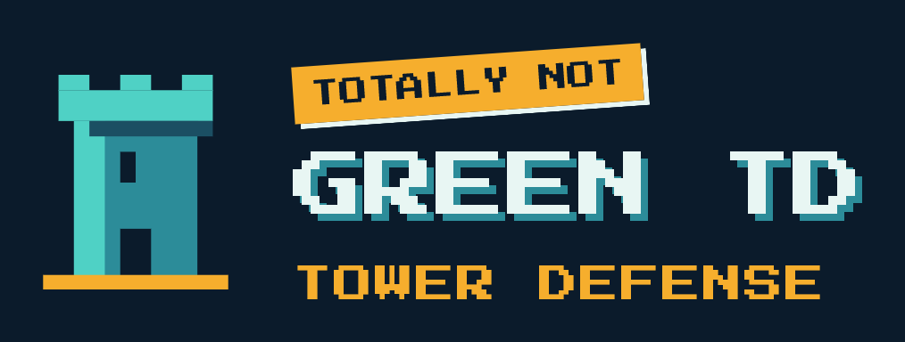
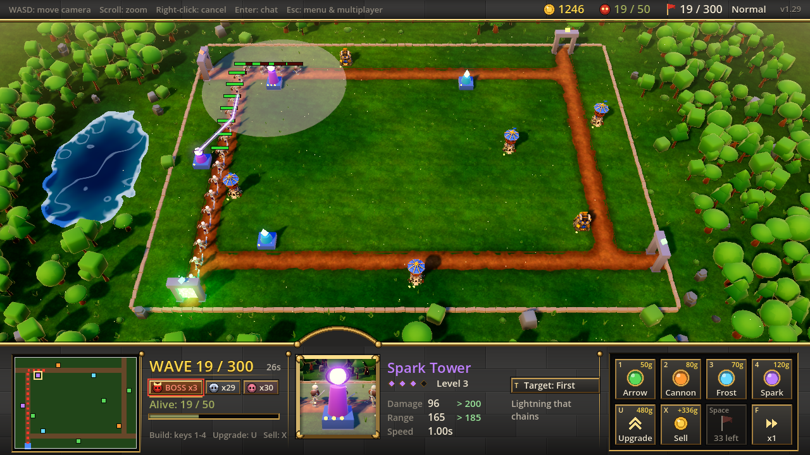

<p align="center"></p>

# Gettic's first TD

A small 3D tower defense game made with [Godot 4](https://godotengine.org/), inspired by the classic Warcraft III custom tower defense maps.


The code for this game was written by Claude. Gettic came up with the ideas, made the choices and play-tested it.



Monsters come out of a green portal in a stone gate at a corner of the map, walk onto a square path and walk around it clockwise, forever, until your towers kill them. Build towers on the grass, upgrade them, and don't let too many monsters pile up: if 50 are alive at the same time, you lose. Survive all 300 waves to win.

Play alone or with up to 4 players: each player gets their own gate at a corner of the square (see [Multiplayer](#multiplayer)). Or draw your own maps in the [Map editor](#map-editor).

The 3D world has a hand-painted look (painted shaders, warm light, a forest and a lake around the board). It uses free CC0 models from the KayKit packs by Kay Lousberg (trees, bushes, rocks and the skeleton mage boss with its walk) and painted CC0 grass and dirt textures by Cethiel (see [assets/CREDITS.md](assets/CREDITS.md)). The Cannon tower (a new look at levels 1-5, 10, 15, 20, 30 and 40 for each path) and the skeleton warrior (with its walk and death) were made for the game with a model kit; the Arrow tower models, the logo and the game icon are by Gettic. Some smaller things are still simple shapes built in code. The game has no sound files.

## Download

**Windows:** download the latest `.exe` from the [Releases page](https://github.com/gettic/Gettics-first-TD/releases/latest) (for example `GetticsFirstTD-v1.15.exe`) and run it. No install needed.

The first time it runs, the game warns you and then unpacks itself into a new **Gettic's first TD** folder next to the download (or click **Choose another folder...** to unpack it straight into a folder you pick), with two files named with the version, for example `Gettic's first TD v1.16.exe` (the Godot engine) and `Gettic's first TD v1.16.pck` (the game itself). The downloaded file is deleted afterwards. From then on, start the game from that folder. When the game updates, both files are renamed to the new version.

When the game starts, and every 30 minutes while it runs, it checks GitHub for a newer version. If one is out, a **New version – Update** button appears at the top of the screen. Click it to see what's new in every version since yours (scroll if it's long) and update with one click: the game downloads the new version and restarts by itself. Usually only the small game file needs to be downloaded; the engine is only downloaded again when it changed.

## Run from source

1. Install [Godot 4.7](https://godotengine.org/download) (the standard version, not .NET).
2. Download this repository (**Code → Download ZIP**) or clone it.
3. Open Godot, click **Import**, select the `project.godot` file, and press **F5** to play.

Or from a terminal:

```
godot --path path/to/this/folder
```

## Controls

| Key / mouse | Action |
|---|---|
| **1–4** or click a tower button | Choose a tower to build (a grid shows on the grass while you place it) |
| **Left-click** on grass | Build the chosen tower |
| **Left-click** on a tower | Select it |
| **U** | Upgrade the selected tower |
| **Q** / **E** or the 2 path buttons | Upgrade a level 4 tower to level 5 and pick its path (see Towers) |
| **X** / **Delete** | Sell the selected tower (70% refund) |
| **T** or the **Target** button in the tower panel | Change which monster the selected tower shoots (see Towers) |
| **Shift+T** or **Shift+click** the Target button | The same, for all your towers of that type |
| **W A S D** | Move the camera |
| **Scroll wheel** | Zoom in and out |
| **Space** | Start the game / send the next wave early (bonus gold, once the current wave has fully spawned; in multiplayer it's a vote, press again to take it back) |
| **F** | Change game speed (1×, 2×, 3×, 5×; in multiplayer only the host can) |
| **Y** / **N** | Say yes or no when another player asks to build in your area |
| **Enter** | Chat: type a message and press **Enter** to send it (**Esc** cancels). Game keys are off while you type |
| **Right-click** | Cancel |
| **Esc** | Menu: pause / continue, pick the **Level** (Easy, Normal, Hard or Insane, before wave 1; see Waves), see the **Leaderboard**, open the **Map editor**, host or join a multiplayer game, and open **Settings**: Graphics High / Low (Low is faster on older PCs; PCs with built-in graphics start on Low), Fullscreen / Windowed, 3D resolution (100 / 85 / 75 / 50%, lower is faster) and anti-aliasing |
| **F11** or **Alt+Enter** | Switch between fullscreen and a window (the game starts in fullscreen the first time and remembers your choice) |
| **R** | Restart after winning or losing |

## Towers

Towers can be upgraded up to level 60. Above level 4 a tower keeps its level-4 look and shows a small "Lv" badge, and big numbers are shortened (240k, 1.2M). From level 5 on, every level adds 28-36% damage (a bit different for each level and tower), and every 5th level (5, 10, 15...) is a big one with 62-70%. Range, fire rate, splash, slow and chain also grow a little, up to a limit. Each upgrade costs 38% more than the last (80% more for the big levels), so very high levels get too expensive to reach.

| Tower | Cost | What it does |
|---|---|---|
| **Arrow** | 50g | Cheap and fast, hits one enemy |
| **Cannon** | 80g | Slow, but damages every enemy near the impact |
| **Frost** | 70g | Less damage, but slows enemies down |
| **Spark** | 120g | Lightning that jumps between several enemies |

**Specializations.** The upgrade from level 4 to 5 picks one of the tower's 2 paths: with a level 4 tower of yours selected, the tower buttons turn into its 2 paths (**Q** and **E**, price and a short text; hover for the numbers). **U** only reminds you to pick. The path is for good: selling is the only way back. Both paths cost the same, and the tower panel shows its path's name. Each path multiplies the tower's normal numbers from level 5 on, and some extras grow at levels 20 and 40:

| Tower | Path | Good against | What it does |
|---|---|---|---|
| Arrow | **Sniper** | Bosses, armored | Damage ×1.6 (×2 more against bosses), fires half as often, range ×1.25, faster arrows. Starts on Strongest |
| Arrow | **Volley** | Crowds | Shoots 3 monsters at once (4 at level 20, 5 at 40), each arrow ×0.5 damage |
| Cannon | **Big Bomb** | Bosses, packs | Damage ×2 (×1.5 more against bosses), fires 1.6× slower, blast ×1.3 |
| Cannon | **Cluster** | Crowds, long lines | Plus 3 bomblets (4 at 20, 5 at 40) on monsters near the blast, each a small blast with full damage. Each monster is hit only once per shot |
| Frost | **Deep Freeze** | Holding monsters | Damage ×2, 25% chance to freeze a monster for 1 second (32% at 20, 40% at 40; bosses half as long). After a freeze, a monster can't be frozen again for 2 seconds |
| Frost | **Blizzard** | Area slow | Hits and slows every monster within 60 of the target (80 at 20, 100 at 40), damage ×0.35 |
| Spark | **Storm** | Crowds | Chains to 3 more monsters, each jump keeps 90% of the damage (instead of 80%) and reaches further, damage ×0.9 |
| Spark | **Overload** | Bosses | Damage ×2 (×2 more against bosses), fires 1.2× slower, chains to only 2 monsters. Starts on Strongest |

**Targeting.** Each tower has a targeting mode that says which monster in range it shoots. Change it with **T** or the **Target** button in the tower panel (only on your own towers). **Shift** changes all your towers of that type at once. New towers start on **First**.

| Mode | Shoots |
|---|---|
| **First** | The monster that has walked furthest. The path loops forever, so this is the oldest one, which has counted toward the limit the longest |
| **Last** | The monster that has walked the least (the newest, near the gates) |
| **Strongest** | The monster with the most health left |
| **Fastest** | The fastest monster right now (slowed ones count as slow, so Frost on Fastest goes for the ones that aren't slowed yet) |
| **Closest** | The monster nearest to the tower |

When two monsters are equal, the one that has walked furthest is picked.

## Waves

- **300 waves.** Monsters get tougher every wave: health grows fast up to wave 25, then by 2.5% a wave. Each gate sends one more monster per wave, up to 32.
- Press **Space** to start. After that, a new wave comes every **25 seconds**, whether you're ready or not.
- Press **Space** to send the next wave early and get **bonus gold for every second** you skip (the wave's gold spread over 25 seconds, at least 1 a second). You can only do this once every monster of the current wave has spawned.
- Every **3rd** wave is **armored**: armor reduces the damage of each hit, and it grows with the monsters' health.
- Every **5th** wave is **fast**.
- Every **10th** wave is a **boss** wave (up to 5 bosses, each with 18 times the health). A boss counts as 5 monsters toward the limit. Sniper, Big Bomb and Overload hit bosses harder.
- **Wave preview:** under the wave number in the console, three small chips show the next 3 waves: the monster kind (by color and mark: speed lines for fast, a steel rim for armored, a crown for a boss), how many come (all gates together), and a blinking red **BOSS** chip before a boss wave. The seconds until the next wave are at the right of the wave number, with a thin gold bar under the first chip.
- The monsters: wave 1 is **unicorns**, after that normal monsters are bone warriors with sword and shield, armored ones are bigger, steel-tinted bone warriors, fast ones are bone spiders and bosses are big skeleton mages. Health bars show once a monster is hurt.

You start with 150 gold (225 on Easy). You earn gold for each kill and a bonus at the start of each wave; both grow with the monsters' health (playing alone, kills pay about 15% more later on). The console at the bottom shows how many monsters are alive: you lose if it reaches **50** (per player, see below). You win when all 300 waves are out and every monster is dead (there are fireworks).

**Stats at the end.** When the game is lost (after a moment) or won (after 3 seconds of fireworks), a panel shows each player's kills, damage, gold earned (wave gold, early bonus and kills) and gold spent on towers (minus what selling gave back), and the 5 towers that did the most damage (sold towers count too). Damage counts only the health a hit really took off. In multiplayer the **MVP** is the player who did the most damage (kills break a tie).

**Levels.** Before wave 1, pick how hard the game is in the **Esc** menu (playing alone, or the host in multiplayer). Gold from waves and kills is the same on every level, so tougher monsters also mean less gold for their health.

| Level | Monster health | Start gold |
|---|---|---|
| **Easy** | ×0.6 | 225 |
| **Normal** | ×1 | 150 |
| **Hard** | ×1.4 | 150 |
| **Insane** | ×2 | 150 |

## Leaderboard

The **Leaderboard** button in the Esc menu shows the online top 10 for the Default map: the highest wave first, then won before lost, then the shortest game time. Each team (the same player names) has one entry, its best game. When a game on the Default map ends, the host sends the team's names and how the game went (wave, result, game time) to the game server. Only the released game sends scores: test runs and debug builds never do. Custom maps don't count. A balance change starts a new board, so old and new scores aren't mixed (the tower specializations started board 2). From board 3 on, **each Level has its own board** (Easy, Normal, Hard and Insane): the box opens on the board of the level you're playing, and you can look at the other levels' boards too.

## Map editor

Playing alone, press **Esc** and click **Map editor** to make your own maps (if a game is going, it asks first, since the editor ends it). The map shows in 3D as you draw it:

- **Path** paints path tiles, **Erase** (or the right mouse button) turns tiles back into grass. Hold the mouse button and drag to paint several tiles.
- **Gate** places a gate: press **1-4** (or click the button again) to pick which one. A gate stands at the end of its own road to the loop.
- **Rock**, **Tree** and **Water** block building (rocks and trees are 3D models, water is a lake with moving waves). **Areas** shows each player's area, **Clear** (click twice) makes the whole map grass.
- **Width** and **Height**: from 12 x 9 up to 48 x 36 tiles.
- **Check** shows whether the map works: the path must be one closed loop, one tile wide, that doesn't touch itself, with at least 8 tiles; gate 1 is needed and gates are numbered without gaps (up to 4, one per player). Monsters always walk the loop clockwise. Very uneven player areas only give a yellow warning.
- **Save** keeps the map under its name (in the game's user folder, maps\<name>.txt), **Load...** opens a saved map or a copy of **Default** (which can't be changed), **New** starts over, **Play this map** starts a game on it, **Exit the editor** goes back to the map you played before. Only working maps can be saved or played.

**Picking a map:** in the **Esc** menu, click the **Map:** button under the title to choose **Default** or one of your saved maps. You can do this playing alone or as the host, before wave 1. While hosting, the map can only change while nobody has joined yet. Saved maps are checked again every time they're loaded.

The map also decides how many can play: **one player per gate** (a map with 2 gates is full with 2 players). Multiplayer games use the host's map; see [Multiplayer](#multiplayer) for how joining players get it.

## Multiplayer

Up to 4 players can defend the map together: one player per gate on the map (the Default map has 4).

- Each player has **their own gate**: on the Default map one at each corner of the square, Blue bottom-left, Red top-left, Yellow top-right, Green bottom-right. Every player's gate sends a full wave, so **more players means more monsters**, and the loss limit grows with it: **50 alive monsters per player** (100 with 2 players, 200 with 4).
- **Each player has their own area**: the part of the map nearest to where their gate's road joins the loop (on the Default map, the quarter around their gate). When you pick a tower to build, your own area goes dark and the other players' areas light up in their color. To build in someone else's area, they have to say yes: a box pops up for them (**Y** for yes, **N** for no). Areas of gates nobody plays are free for everyone.
- **Sending a wave early is a vote**: pressing **Space** votes for it, and the wave comes once at least **75% of the players** agree (2 of 2, 3 of 3, or 3 of 4). The button shows the votes, like `2/3`. Press **Space** again to take your vote back. Starting the first wave doesn't need a vote.
- **Everyone has their own gold.** Every player gets the wave bonus, and the gold for a kill goes to the player whose tower made it. Tower bases are tinted in the owner's color, and you can only upgrade or sell your own towers.
- You can start hosting in the middle of a game and keep your towers. A player who joins late gets some extra gold to catch up. If a player leaves, their gate closes and their towers stay.
- **The host picks the Level** (before wave 1), for everyone: the other players see it, also when they join later, and a won or lost game goes on that level's leaderboard.
- **The stats at the end** are counted by the host and sent to everyone once when the game ends, so all players see the same numbers (a player who left still shows up; a player who joins a slot later starts fresh).
- In multiplayer, **Esc doesn't pause** the game.
- **Names and chat:** type your name in the **Your name** box in the **Esc** menu (up to 16 letters; the game remembers it). Leave it empty and you get a random silly name, like *Sir Wobbles* or *Captain Noodle*. Two players with the same name get a number added. Press **Enter** to chat: messages show above the small map in the bottom-left, in each player's color, and fade after a few seconds.

**How to play together**

1. The host presses **Esc** and clicks **Host a game and get an invite code**.
2. The other players press **Esc**, type the code in the box and click **Join**.

**Playing on your own map**

The host picks the map in the **Esc** menu before inviting anyone (see [Map editor](#map-editor)); once someone has joined, the map stays until the game is over. A player who doesn't have the host's map yet gets a **Join game** box first: a preview of the map, its name, size, gates and trees, rocks and water. Nothing is downloaded into the game or saved until they click **Download and join**; **Cancel** (or **Esc**) leaves everything as it was. Only the map's tiles come over (under 2 KB), never files, and the game checks them just like the map editor does, so a broken or strange map is refused with a message. Tick **Keep this map in my map list** to save it among your own maps (a name you already use gets " (2)"). Players who already have the same map, and games on the Default map, skip the box. After leaving the game, you're back on your own map.

The invite code is 5 letters and digits (like `JR61X`). It works for anyone, anywhere: the game connects through a small game server, so nobody has to change anything in their router.

**Public and private games**

A new game is **private**: only friends with the code can join. The host can click **Public game** in the menu to turn it on, and then the game shows up under **Public games** in everyone's menu (if it isn't full), where anyone can click it to join. Click it again to make the game private again. The list only shows games with your version of the game.

**If the game server can't be reached**

For example with no internet: the game then hosts on your own network instead, still with a 5-letter code, and only friends on the same **Wi-Fi** can join. When you join, the game always looks for the code on your own network first, then asks the game server. The first time you host this way, Windows may ask whether to let the game through the firewall: click **Allow**.

Everyone needs the same game version.

## Changing the game

The game code is split into a few files, each building on the one before:

| File | What's in it |
|---|---|
| `game_base.gd` | All the settings (constants) and the game's shared state |
| `game_updates.gd` | Checking for updates, unpacking the downloaded `.exe`, and the debug log window |
| `game_world.gd` | The 3D world: map, gates, tower and monster models, shots and effects |
| `game_net.gd` | Multiplayer: hosting, joining, invite codes, public games |
| `game_ui.gd` | The bottom console (small map, tower portrait, command buttons), menus and popups |
| `map_editor.gd` | The map editor and saved maps |
| `main.gd` | The game itself: waves, monsters walking, towers shooting, keys and clicks |

Good places to start:

- `TOWER_BASE` in `game_base.gd` sets each tower's cost, damage, range and fire rate for levels 1-4. `LEVEL_GAIN`, `LEVEL_COST` and the other `LEVEL_` values set how the levels after that grow (`make_towers()` works them out). `PATHS` sets the 2 specializations of each tower (their numbers times the normal ones from level 5 on); their rules are in `update_towers()`, `fire_lightning()` and `shot_hit()` in `main.gd`.
- `BOARD_SEASON` in `game_net.gd` is part of the leaderboard's name: raise it after a balance change, so new scores aren't mixed with old ones.
- `GAME_SPEEDS` in `game_base.gd` are the speeds the **F** button goes through.
- `wave_hp()`, `wave_count()`, `wave_income()` and `wave_bounty()` in `game_base.gd` set each wave's monster health, how many come out of each gate, the wave gold and the gold per kill.
- `DIFFICULTIES`, `DIFFICULTY_HP` and `DIFFICULTY_GOLD` in `game_base.gd` are the levels and what each one does to monster health and start gold. To test a level before the menu has its button, start the game with `-- --level=hard` (or easy, normal, insane).
- `START_GOLD`, `MAX_ALIVE`, `WAVE_INTERVAL` and `MAX_WAVE` set the starting gold, the monster limit (per player), the time between waves and the number of waves.
- `EARLY_VOTE` sets the share of players (0.75 = 75%) who must agree to send a wave early in multiplayer.
- `DEFAULT_MAP` in `game_base.gd` is the map, one letter per tile: `.` grass, `#` path, `1`-`4` a player's gate, `r` rock, `t` tree, `w` water (nothing can be built on these). `read_map()` checks it: the path must be one closed loop, one tile wide, and each gate must stand at the end of its own road to the loop. Monsters walk from their gate to the loop and then around it clockwise. Each player's area is the part of the map nearest to where their gate's road joins the loop.
- `PLAYER_COLORS` and `PLAYER_NAMES` set each player's color and its name (used when a player has no name), and `SILLY_NAMES` is the list of random names for players who leave the name box empty.
- `ZOOM_MIN`, `ZOOM_MAX` and `ZOOM_STEP` set how far you can zoom in and out, and how much each scroll notch zooms.
- `start_wave()` and `spawn_enemy()` in `main.gd` start each wave and give each monster kind its health, armor and gold.
- `build_world()` in `game_world.gd` sets up the 3D scene: camera angle, lighting, haze and effects; `build_map()` the ground (painted grass and dirt, see `assets/shaders/ground.gdshader`) and the land around the board. Models get the painted look of `assets/shaders/painted.gdshader` (see `painted()`). `build_gate()` builds the gates, and `build_tower_node()` each tower's 3D model. Model files (like the Arrow tower's) are in `assets/`, with their sources in `assets/CREDITS.md`.
- `RELAY_URL` in `game_base.gd` is the game server's address, and `NET_PORT` and `SEARCH_PORT` are the network ports used for games on your own network.
- `GAME_FOLDER` and `GAME_NAME` in `game_base.gd` set the names of the folder and files the downloaded `.exe` unpacks into.
- The game server is a small Cloudflare Worker, kept outside this repository.
- To see errors while testing, start the game with `godot --path . -- --debug-log`: a second window lists every error, warning and print (**F12** shows and hides it). The **Windows Debug** export preset builds a separate debug .exe that always has this window and never unpacks or updates itself.
